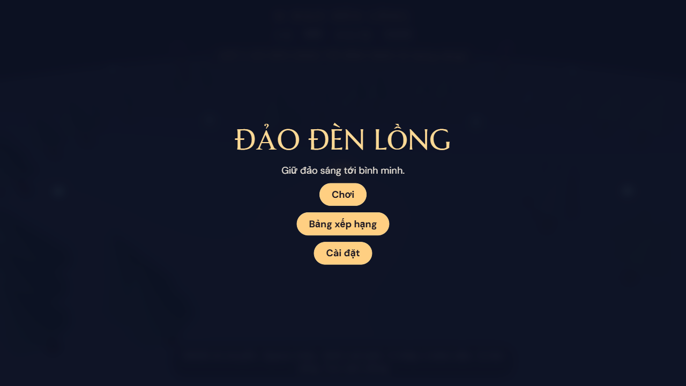
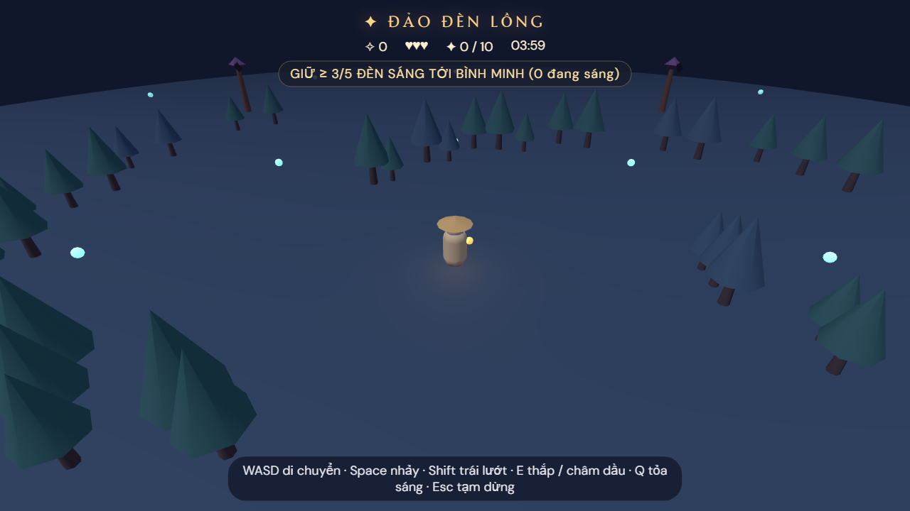

# Đảo Đèn Lồng

> **Video demo:** https://www.youtube.com/watch?v=H4f8KESbaBg  hoặc `docs/demo/demo.mp4`

Game 3D góc nhìn thứ ba chạy trên trình duyệt (Three.js + TypeScript). Mây gom đom đóm, thắp và **giữ cho đèn lồng sáng tới bình minh**, né Bóng Mực (chúng hút dầu của đèn yếu) và dùng Tỏa Sáng để làm chúng choáng. Ba Đêm: Đảo Bến, Hai Đảo, Đỉnh Chuông.

 

## Yêu cầu hệ thống
- Node.js 20+ (đã thử trên 22) và npm.
- Trình duyệt có WebGL (Chrome, Edge, Firefox). Bench/e2e cần Chrome hoặc Edge (đặt `BROWSER_PATH` nếu không ở vị trí chuẩn).
- Windows, macOS hoặc Linux.

## Cài đặt và chạy (3 lệnh)
```bash
npm install
npm run build
npm start        # mở http://127.0.0.1:4173/
```
Chế độ phát triển (hot reload): `npm run dev` rồi mở URL Vite in ra. Chơi thẳng một Đêm: thêm `?night=1|2|3`.

## Điều khiển (đổi được trong Cài đặt)
| Phím mặc định | Hành động |
| :-- | :-- |
| W A S D / mũi tên | Di chuyển |
| Space | Nhảy |
| Shift trái | Lướt |
| E | Thắp đèn / thắp lại / châm dầu |
| Q | Tỏa Sáng (tốn 1 Ngọn Lửa, làm Bóng Mực choáng) |
| Esc / P | Tạm dừng |

**Luật chính (v1.2):** thắp đèn tốn 10 đom đóm (thắp lại 5); đèn hao 1 dầu/giây và tắt khi hết; Bóng Mực hút dầu đèn có `fuel < 30`; thắng khi còn sống lúc bình minh với ≥ 60% số đèn sáng (3/5, 4/6, 5/7). Sức chứa tăng 2 mỗi lần thắp (tối đa 20). Chi tiết: [ADR-003](docs/adr-003-fuel-and-dawn-win.md), [CHANGELOG](CHANGELOG.md).

## Dễ tiếp cận
Đổi phím mọi hành động (có báo trùng phím, khôi phục mặc định); chỉ báo hình ảnh + mũi tên cho Bóng Mực xuất hiện, gió sắp thổi, 10 giây cuối, đèn sắp hết dầu; **Giảm chuyển động**; **Bảng màu dễ phân biệt**; chữ ≥ 18 px (tùy chọn ×1.25). Tất cả được lưu.

## Bảng xếp hạng
Sau khi thắng Đêm 3 hoặc thua ở bất kỳ Đêm nào, nhập tên (3–12 ký tự `[A-Za-z0-9_]`) để lưu `tổng điểm các Đêm đã thắng`. Top 10, bằng điểm thì ai đạt trước đứng trên. Dữ liệu lưu ở `data/leaderboard.json` (đổi bằng biến môi trường `LEADERBOARD_FILE`); nếu chạy không có server thì dùng localStorage. Xuất ra tệp:
```bash
npm run dev -- --export-leaderboard out.json     # {"entries": [...]} đúng thứ tự
```

## Test
```bash
npm test               # Phase 3 (22 ca) + Phase 4 (13 ca, gồm soak thu nhỏ)
npm run test:e2e       # 13 kiểm tra trên trình duyệt thật (cần `npm run build` trước)
```

## Headless / Test Contract (v1.3)
```bash
npm run headless -- --seed 12 --night 1 --ticks 600 --out result.jsonl
npm run headless -- --seed 12 --night 1 --scenario scenario.json --inputs inputs.json --ticks 600 --out result.jsonl --snapshot-every 10
```
Mô phỏng 60 Hz cố định, cùng seed + input → cùng kết quả; output JSONL gồm `snapshot`, `event`, `end`. Tuning và lệnh khai báo trong [`game.contract.json`](game.contract.json) (`bench_cmd`, `soak_cmd` thêm ở v1.3). Fixture Phase 2: `tests/phase2/`; test luật Phase 3/4: `tests/phase3/`, `tests/phase4/`.

## Benchmark
```bash
npm run build
npm run bench -- --seed 42 --duration 30 --out bench.json
```
Mở cửa sổ Chrome/Edge 1280×720 (không toàn màn hình) với cờ `--disable-frame-rate-limit --disable-gpu-vsync` (tắt vsync; `vsync_off: true` nghĩa là các cờ này đã được áp dụng, xác nhận bằng `avg_fps` vượt tần số quét màn hình). Cảnh chuẩn: Đêm 1 đầy đủ ánh sáng, 200 Bóng Mực `wander`, 100 đom đóm, `L1–L3` sáng fuel 100, Mây đứng yên ở gốc, camera bay vòng R=30 m, Y=15 m, 15 s/vòng; 3 s khởi động rồi đo `--duration` giây. Thoát mã 0.

`peak_mem_mb` là tổng RSS/working set của **toàn bộ cây tiến trình trình duyệt** (profile riêng), nên lớn hơn bộ nhớ riêng của trang. `load_ms` tính từ lúc lệnh bắt đầu (gồm khởi động server và trình duyệt) tới khung hình đầu tiên của cảnh bench.

Kết quả tự đo (máy phát triển, **không phải máy chấm**): [`bench.json`](bench.json) — `avg_fps` 261.1, `p1_low_fps` 118.9, `frame_ms_p95` 5.7, `load_ms` 1850 (ngưỡng: ≥ 60 / ≥ 30 / ≤ 10000), Intel Iris Xe, i5-12500H, Chrome 157 / ANGLE D3D11.

## Soak test
```bash
npm run soak -- --seed 7 --nights 10 --out soak.json
```
10 Đêm liên tiếp trong một tiến trình (Đêm 1→2→3 xoay vòng, Đêm thứ `i` dùng seed `7+i`, `i = 1..10`); input ngẫu nhiên theo seed (đổi hướng mỗi 30 tick; mỗi tick: nhảy 5%, lướt 3%, tỏa sáng 2%, tương tác 10%). Đạt khi `crashes = 0` và `mem_end_mb ≤ 1.2 × mem_start_mb`. Kết quả tự đo: [`soak.json`](soak.json) (0 crash, 69 → 72 MB). Lưu ý trung thực: với input ngẫu nhiên Mây thường rơi khỏi đảo hoặc hết Ngọn Lửa sau vài trăm tick, nên mỗi Đêm kết thúc sớm (≈ 14 000 tick mô phỏng tổng cộng); cờ `--idle` chạy không input để tham khảo thêm.

## Đóng gói phát hành
```bash
npm run build && npm run package     # -> release/dao-den-long-v1.0.0-web.zip (web tĩnh + server Node nhỏ)
```
Giải nén rồi `node scripts/start.mjs` (xem `HOW-TO-RUN.md` trong gói).

## Giả định và ghi chú
- Phase 1–2: [`docs/phase-2-spec.md`](docs/phase-2-spec.md) (một số số liệu Ticket-02 được giả định). Phase 3: [ADR-003](docs/adr-003-fuel-and-dawn-win.md). Phase 4: không đổi luật chơi.
- Phần "sáng tạo" (đảo đêm sương mờ, cây low-poly, Mây đội nón lá) chỉ thuộc lớp trình bày, không ảnh hưởng mô phỏng headless; không có thực thể sáng tạo nào trong cảnh benchmark/soak.
- Retro và bằng chứng: [`docs/retro.md`](docs/retro.md), [`docs/proof/`](docs/proof/).

## Credits và giấy phép
Xem [CREDITS.md](CREDITS.md) (không dùng asset ngoài; công cụ AI được liệt kê) và [LICENSE](LICENSE) (MIT).
